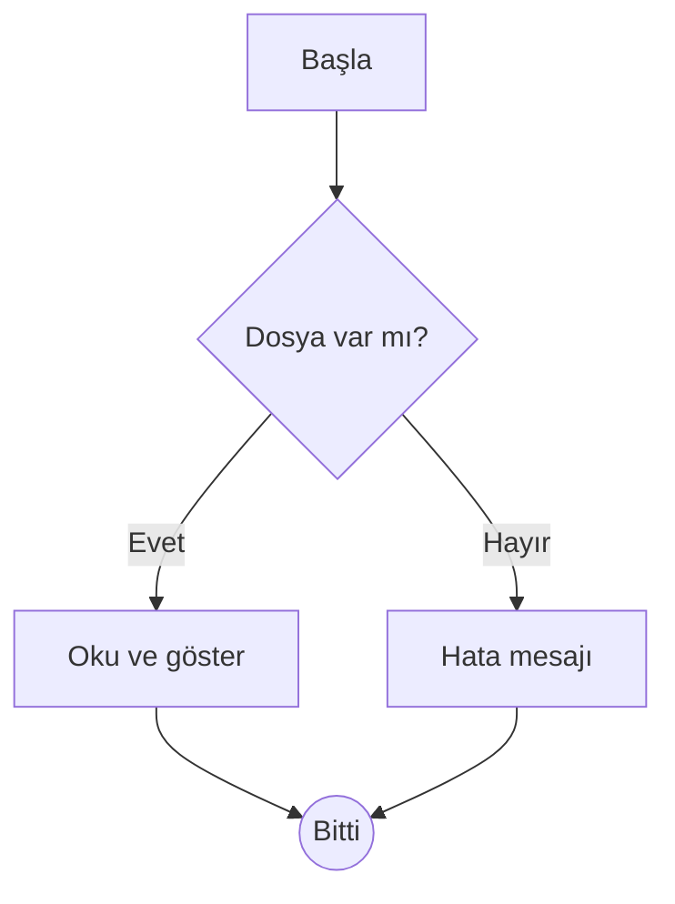
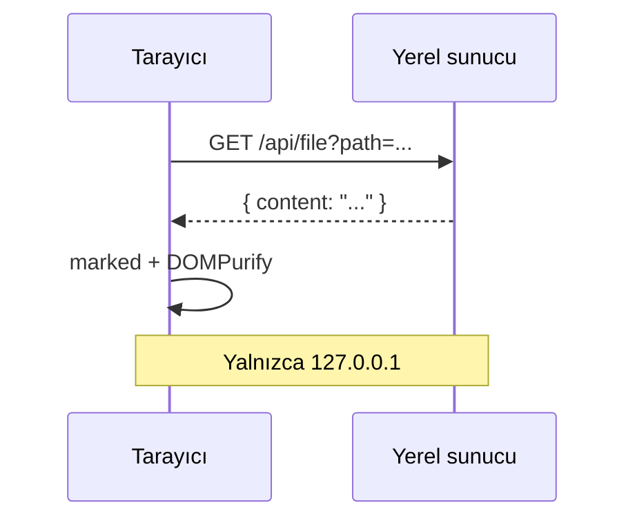

# Gelişmiş Özellikler

Bu belge Mermaid diyagramlarını, dipnotları ve KaTeX matematiğini gösterir.

## Akış şeması



## Sequence diyagramı



## Hatalı Mermaid bloğu

Aşağıdaki blokta sözdizimi hatası var; sayfa bozulmamalı, kaynak ve bir hata mesajı görünmeli:

```mermaid
flowchart TD
    A[Başla] --> 
    B -->-->> ((
```

## Dipnot örnekleri

Markdown, John Gruber tarafından geliştirildi[^gruber]. GitHub tarzı Markdown birçok
eklenti getirir[^gfm]. Aynı dipnota ikinci kez başvurulabilir[^gruber].

[^gruber]: İlk sürüm 2004 yılında yayımlandı.
[^gfm]: Tablolar, görev listeleri ve **dipnotlar** gibi. Dipnot içinde formül de olur: $a^2 + b^2 = c^2$.

## Matematik

Satır içi formül: Einstein'ın ünlü denklemi $E = mc^2$ ve Euler özdeşliği $e^{i\pi} + 1 = 0$.

Blok formül:

$$
\int_{-\infty}^{\infty} e^{-x^2}\,dx = \sqrt{\pi}
$$

$$
\sum_{n=1}^{\infty} \frac{1}{n^2} = \frac{\pi^2}{6}
$$

Matris: $\begin{pmatrix} a & b \\ c & d \end{pmatrix}$

## Matematik sayılmaması gerekenler

Fiyatlar 5$ ve 10$ arasında değişir. Bir başka örnek: $5 ile $10 arası.

Kaçışlı dolar işareti: \$x\$ formül değildir.

Satır içi kodda dolar: `echo $HOME ve $PATH` olduğu gibi kalır.

```bash
#!/bin/bash
fiyat=5
echo "Toplam: $fiyat$ ve $((fiyat * 2))"
export PATH="$HOME/bin:$PATH"
```
